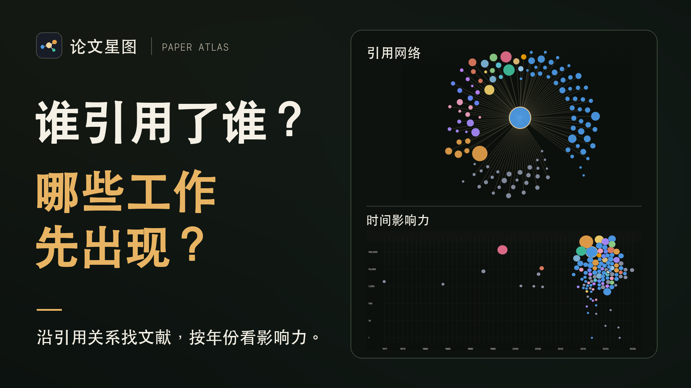

# 论文星图 · Paper Atlas

从一篇论文出发，沿**引用网络**找相关文献，用**时间影响力图**按年份梳理研究脉络。两个视图联动，适合做文献综述。

[](docs/media/walkthrough.mp4)

[下载 macOS 版](https://github.com/topologyih/paper-atlas/releases/latest) · [看 30 秒演示](docs/media/walkthrough.mp4) · [详细使用指南](docs/guide.md)

## 快速开始

**macOS 下载包**需要本机 Python 3。解压后打开「论文星图.app」。

**从源码运行**需要 Node.js 22 或更高的偶数版本。

```bash
git clone https://github.com/topologyih/paper-atlas.git
cd paper-atlas
npm ci
npm run dev
```

打开终端显示的地址。内置 Transformer 示例可直接看，无需注册。

## 配置 OpenAlex API 密钥

经常用自己的 DOI 生成新图谱时，可以申请免费密钥。

1. 注册账号并验证邮箱，再登录。[注册 OpenAlex](https://openalex.org/signup)
2. 在设置里复制个人密钥。[打开 API key 设置](https://openalex.org/settings/api)
3. 在源码根目录的 `.env.local` 里填入 `VITE_OPENALEX_API_KEY=你的密钥`，重启 `npm run dev`。输入 DOI 后点击「生成图谱」。

这份密钥配置仅供本机使用。公开构建前保持该变量为空。[本地后端配置](docs/guide.md#本地-api-与密钥)
